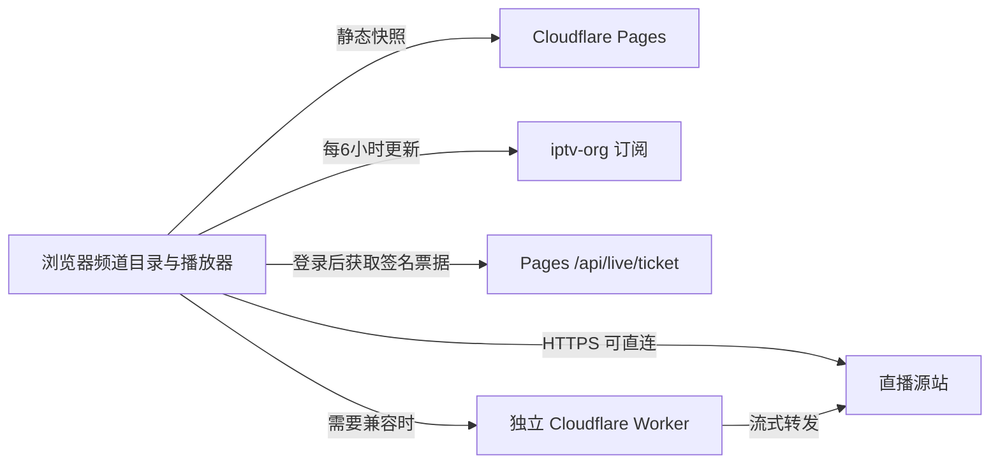

# 电视直播

TV 使用 [iptv-org 全量订阅](https://iptv-org.github.io/iptv/index.m3u)。保留 MoonTV 登录与现有播放器，参考 [Wizju IPTV Player](https://github.com/j2jstudio/wizju-iptv-player) 的客户端目录和虚拟列表方式，不额外加载第二套 Vue/Video.js 应用。

## 目录与界面

- 目录下载、解析、国家／分类标签和搜索全部在浏览器完成，不再调用旧 `/api/live` 聚合目录。
- 初次访问同时加载本站静态快照与官方订阅，快照先显示，官方成功后替换。快照按需获取，不进入全站离线预缓存。
- IndexedDB 与内存缓存 6 小时；重新打开页面、定时检查或回到标签页时按需更新，手动更新可跳过缓存。官方失败保留旧目录。
- 每 500 行解析让出主线程。频道列表仅渲染当前可见行和少量预留行，1 万条频道不会创建 1 万个卡片节点。
- 按 `tvg-id` 保留稳定频道身份，支持国家、分类、地区、搜索、收藏和最近观看。分类和目录更新不打断当前直播。购物频道统一过滤。
- `.github/workflows/iptv-catalog.yml` 每天同步官方静态快照；更新失败保留上次文件。GitHub 长期无活动可能暂停定时工作流，浏览器直接订阅仍独立运行。
- 2026-11-12 快照含 11,461 条线路，经解析与购物／协议／地址过滤得到约 11,279 个 feed 条目，含 158 个 CN 条目。不同语言／画质 feed 不强行混为一台；目录数量不代表全部可播放。

## 低资源播放

自动模式优先直连无需特殊头的 HTTPS 线路（包括海外频道）。HTTP、订阅指定 Referer/User-Agent 或直连失败的线路才使用独立 Worker。用户仍可手动选择直连／转发。

不再自动检测所有备用线路，不在后台下载预检分片；只加载当前线路，真正失败后才尝试下一路径／线路。HLS 缓冲上限 12 秒，无历史回看缓存，换台及时取消请求。无法通过代理修复源站已失效、地区授权限制或浏览器不支持的编码。

直播清单、签名请求与媒体分片排除 PWA 离线缓存，包含 Safari 原生 HLS 请求。

播放器显示授权、清单、分片、解码、缓冲阶段，以及阶段等待时间、剩余时限和带时间戳的连接记录；错误直接显示 HTTP 状态、Worker 返回的源站原因及换线过程，诊断中隐藏签名 URL。直连首帧总时限 25 秒，转发授权最多 10 秒、授权后首帧最多 30 秒；首帧前重复 waiting 不延长时限，播放后缓冲恢复最多 20 秒。临时网络故障最多重试 2 次，间隔 1.5／3 秒（上限 4 秒），明确的资源错误直接进入失败处理；这些请求仍受总时限约束。解码器只自动恢复一次。已暂停或等待用户点击播放时不伪报网络超时。

直播组件禁用 Artplayer 自带的五次 URL 重载，避免与 HLS 恢复并行。浏览器支持时优先 HLS.js，以便提供资源级错误；原生 HLS 回退只能报告浏览器公开的媒体事件与错误，不伪造 HTTP 状态。诊断只观察正在播放的请求，不额外探测频道。国内／海外筛选栏独立于频道列表收缩，低高度窗口中也保留按钮高度。

## 独立代理

Pages 只负责已有站点登录和轻量票据，不承载直播视频分片。Worker 不解析全量目录、不缓存视频。请求额度只随实际转发的当前播放流消耗。

`workers/live-proxy/` 提供可部署 Worker，参考 [HLS-Proxy-Worker](https://github.com/MHSanaei/HLS-Proxy-Worker)，增加完整主／子清单、音轨、KEY、MAP 和分片重写。配置与命令见 [Worker 部署说明](../workers/live-proxy/README.md)。

Pages 环境配置：

- `LIVE_PROXY_ORIGIN`：独立 Worker 的 HTTPS origin，不含路径。
- `LIVE_PROXY_SECRET`：随机至少 32 字符，与 Worker Secret 相同。

Worker 环境配置：

- `LIVE_PROXY_SECRET`：同上。
- `ALLOWED_ORIGINS`：允许的站点 origin，生产为 `https://tv.markoo.cn`。

POST `/api/live/ticket` 沿用站点认证，限制请求体、公共 HTTP(S) 地址及签名请求头，返回 4 小时能力票据，不将站点 Cookie／Authorization 发给 Worker 或源站。源目录来自公开订阅，但此端点也允许已登录用户为合法公共资源获取票据；它不是不登录即可使用的通用代理。

Worker 核验 HMAC、有效期、CORS，逐跳拒绝私网／保留字面地址，转发 Range，流式读取和取消分片。子票据不能超过根票据有效期；播放器会在过期后显示错误，可重试重新获取票据。域名 DNS 重绑定无法仅靠 URL 字面检查完全消除，应保持站点访问私有。

旧 `/api/live` 与 `/api/live/stream` 留作旧客户端兼容，新的 TV 页面不再使用它们。

## 验证与限制

单元测试覆盖目录去重和过滤、缓存并发、1 万频道虚拟列表、无需测速直接播放、失败换线、签名／过期／请求头／重定向和媒体重写。浏览器使用可控 H.264/AAC 测试视频验证真实解码与代理链路。真实频道还取决于用户网络、源站和 Cloudflare 出口，不能将快照或 HTTP200 宣称为全部可播。
